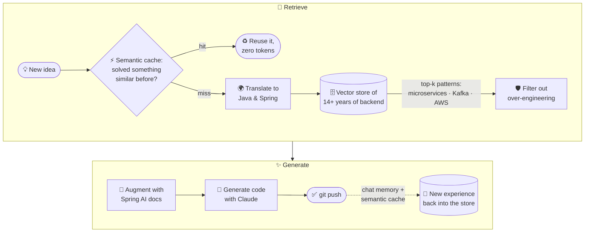

<!-- ============================  HEADER  ============================ -->
<p align="center">
  
</p>

<p align="center">
  
</p>

<p align="center">
  
  <a href="https://www.linkedin.com/in/souissimedmehdi/"></a>
  <a href="mailto:souissimedmehdi@yahoo.fr"></a>
</p>

---

## ☕ `new MohamedMehdiSouissi()`

```java
@Service
public class MohamedMehdiSouissi implements BackendEngineer, Architect, LifelongLearner {

    private final int yearsOfExperience = 14;   // and counting
    private final String certification  = "Oracle Certified Professional, Java SE 11 Developer";

    private final List<String> expertIn = List.of(
        "Java & the Spring ecosystem",
        "Microservices & distributed systems",
        "Event-driven architecture with Apache Kafka",
        "SQL / NoSQL data modeling",
        "AWS & serverless",
        "Technical leadership & code reviews");

    private final List<String> speaks = List.of(
        "Arabic (native)", "French (advanced)", "English (advanced)", "Java (fluent 😄)");

    @Scheduled(cron = "0 0 20 * * *")   // evenings & weekends
    void learnGenerativeAI() {
        explore("LLMs", "RAG", "MCP", "AI Agents");
        build("github.com/souissimehdi/spring-ia");
    }
}
```

---

## 🧠 How my GitHub works (a RAG pipeline, obviously)



---

## 🎯 Areas of expertise

<table>
<tr>
<td width="50%" valign="top">

### ☕ Java & Spring
Modern Java (21) and the whole Spring ecosystem: Boot, Data JPA, Security, Batch,
Integration, MVC. Clean, testable and maintainable backend code.

### 🧩 Microservices & distributed systems
Domain-oriented microservices, shared domain models, configurable processes,
resilience and consistency across services.

### ⚡ Event-driven architecture
Asynchronous communication and distributed processing with **Apache Kafka**,
plus ActiveMQ, Mule ESB and Apache Camel integrations.

</td>
<td width="50%" valign="top">

### 🗄️ Data, SQL & NoSQL
PostgreSQL, MongoDB, Redis, Cassandra, Elasticsearch, MySQL, SQL Server.
Choosing the right store for each job.

### ☁️ AWS & serverless
S3, Lambda, Step Functions, the AWS SDK, and now **Bedrock** for generative AI.

### 🧭 Technical leadership
Architecture and design decisions, code reviews, mentoring, Agile/Scrum
ceremonies, estimation and Git flow strategy.

</td>
</tr>
</table>

---

## 🤖 Side quest: Generative AI with Spring

<table>
<tr>
<td width="60%" valign="top">

### 🌱 [spring-ia](https://github.com/souissimehdi/spring-ia)

**Spring Boot 4 + Spring AI 2** talking to **Anthropic Claude on AWS Bedrock**, grown
commit by commit from a hello-world endpoint into a full RAG stack with semantic caching:

- 💬 `ChatClient`, prompt templates, advisors, streaming
- 🧱 Structured output → records, lists, maps
- 🧠 Per-user chat memory persisted with JDBC
- 📚 RAG: **Tika → chunking → Titan embeddings → Qdrant**
- 🌐 Web-search RAG with **Tavily**
- 🛡️ Query translation and **PII masking**
- ⚡ **Semantic caching**: similar questions are answered from the cache, with no LLM call (Redis, then Qdrant)

</td>
<td width="40%" valign="top">

```text
   question
      │
      ▼
 ┌───────────┐  hit
 │  cache?   │─────▶ cached answer
 └─────┬─────┘ miss
       ▼
 ┌───────────┐
 │ translate │ pre-retrieval
 └─────┬─────┘
       ▼
 ┌───────────┐
 │  Qdrant   │ top-k chunks
 └─────┬─────┘
       ▼
 ┌───────────┐
 │ mask PII  │ post-retrieval
 └─────┬─────┘
       ▼
 ┌───────────┐
 │  Claude   │ grounded answer
 └───────────┘
```

</td>
</tr>
</table>

```diff
+ ✅ ChatClient · prompts · advisors · structured output
+ ✅ Chat memory (JDBC)
+ ✅ RAG with Qdrant · advanced RAG (pre/post-retrieval, web search)
+ ✅ Semantic caching — Redis, then Qdrant
! 🔄 Tool calling — letting LLMs call Java methods
! 🔄 Model Context Protocol (MCP) — clients & servers
- ⏳ AI evaluators · observability (Prometheus, Grafana, OpenTelemetry)
- ⏳ A real-world AI agent
```

---

## 🛠️ Tech stack

<p align="center">
  
  <br/>
  
</p>

| Domain | Technologies |
|---|---|
| **Backend** | Java 21 · Spring Boot 4 · Spring Framework 6 · Spring Data JPA · Spring Security · Spring Batch · Spring Integration |
| **Architecture** | Microservices · Distributed systems · Event-driven architecture · Design patterns |
| **Messaging** | Apache Kafka · ActiveMQ · Zookeeper · Mule ESB · Apache Camel |
| **Data** | PostgreSQL · MongoDB · Redis · Cassandra · Elasticsearch · MySQL · SQL Server |
| **Cloud** | AWS S3 · Lambda · Step Functions · Bedrock · AWS SDK |
| **Generative AI** | Spring AI · Claude · RAG · Qdrant · embeddings · semantic caching · MCP |
| **Workflow / BPM** | Camunda · BPMN 2.0 · Quartz Scheduler |
| **Quality & DevOps** | JUnit · Selenium · SonarQube · Jenkins · Docker · Git flow |

---

## 📊 GitHub stats

<p align="center">
  
  
</p>

---

<p align="center">
  <code>while (curious) { learn(); build(); share(); git push; }</code>
</p>

<p align="center">
  
</p>
